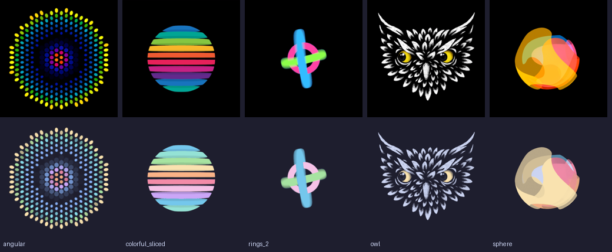
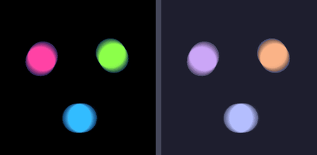
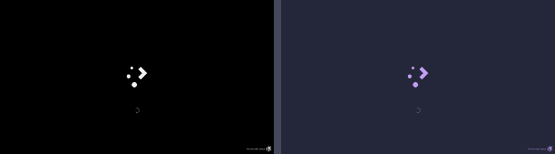

# catppuccinizer

Recolour your boot chain and desktop with [Catppuccin](https://catppuccin.com)
(Latte, Frappé, Macchiato, Mocha):

- **[Plymouth](#plymouth)**: any boot splash theme folder (`script`, `two-step`,
  `fade-throbber`…), or any of the 80 animations of
  [adi1090x/plymouth-themes](https://github.com/adi1090x/plymouth-themes), fetched by name;
- **[Wallpapers](#wallpapers)**: flat art, photos and SVG logos;
- **[Limine](#limine)**: boot menu colours and a recoloured wallpaper;
- **[KDE splash screen](#kde-splash-screen)**: the Plasma splash shown after login.

The original colours are **detected automatically**, mapped to the Catppuccin
palette, and **any colour can be remapped by hand**. Anti-aliasing, glow,
shading and transparency are preserved.



## Quick start

Requires Python 3.11+ with `numpy` and `Pillow`, and `git` (for adi1090x themes).

```bash
pipx install git+https://github.com/erratos/catppuccinizer.git   # or: pip install --user …
```

or run it from a clone, without installing: `./catppuccinize …` in the repository.

```bash
catppuccinize plymouth rings_2 -a mauve --test      # an adi1090x theme, shown without rebooting
catppuccinize plymouth rings_2 -a mauve --install   # install + rebuild the initramfs
catppuccinize plymouth /usr/share/plymouth/themes/spinner -a mauve   # a theme you have

catppuccinize image ~/Pictures/wall.jpg -f macchiato          # -> ./wallpapers/
catppuccinize limine -a mauve --recolor-wallpaper             # -> ./themes/limine-…
catppuccinize ksplash org.kde.breeze.desktop -a mauve --test  # KDE splash screen
```

Every target shares `-f/--flavor`, `-a/--accent`, `-m/--map`, `--preview` and
`-o/--out` (outputs go to `./themes/` or `./wallpapers/` by default); see
`catppuccinize <target> --help`.

Ready-made themes built with the tool (Plymouth hexa_retro and infinite_seal in
Mocha) are published in [catppuccinized-themes](https://github.com/erratos/catppuccinized-themes).

## Plymouth

### Examples

Left: original. Right: generated theme.

#### Automatic detection: `angular` in Macchiato

```bash
catppuccinize plymouth angular -f macchiato
```

```
angular: background #000000
  blue       #0129aa -> blue  (24%)
  orange     #ff8800 -> peach  (19%)
  blue-2     #0199c5 -> sky  (18%)
  yellow     #ffec01 -> yellow  (12%)
  purple     #2b08ac -> mauve  (11%)
  pink       #f00048 -> red  (11%)
  green      #67bb02 -> green  (6%)
```


Even a rainbow is split into hue clusters, each mapped to the closest Catppuccin colour.

#### Manual mapping: `rings_2` with your own colours

```bash
catppuccinize plymouth rings_2 -m pink=mauve green=peach blue=lavender
```



#### Accent mode: `cyanide` in Frappé peach

```bash
catppuccinize plymouth cyanide -f frappe -m cyan=accent -a peach
```


Colours mapped to `accent` produce one theme per accent passed with `-a`
(`-a all` gives the 14 of them). The white ring keeps `text`.

#### Any theme folder: `glow` (two-step), with per-group mapping

```bash
catppuccinize plymouth /usr/share/plymouth/themes/glow -f macchiato -a mauve \
    -m throbber.white=accent ui.white=lavender
```

```
Bizcom Glow [two-step]
  progress (33 images, transparent)
    white      #ffffff -> accent  (100%)
  throbber (20 images, transparent)
    white      #ffffff -> accent  (87%)
    yellow     #f9a905 -> yellow  (13%)
  ui (4 images, transparent)
    white      #ffffff -> lavender  (100%)
```


Each animation sequence and the UI pieces (password box, lock, bullets…) are
detected separately; `group.name=target` remaps a colour in one group only.
The two-step colours of the `.plymouth` file (background, progress bar) are
rewritten too.

### Hand-tuned themes

`hexa_retro` and `infinite_seal` have hand-tuned configs shipped with the tool;
`catppuccinize plymouth` without a theme builds both (Mocha, all accents). The
results are published, with previews, in
[catppuccinized-themes](https://github.com/erratos/catppuccinized-themes).

```bash
catppuccinize plymouth hexa_retro infinite_seal -f latte -a mauve blue
```

### Supported themes

| Module | What is recoloured |
|---|---|
| `script` | all images, `Window.SetBackground…Color` calls (or added), white `Image.Text` colours |
| `two-step` | all images, `BackgroundStartColor`/`EndColor`, progress bar colours (alpha kept) |
| others (`fade-throbber`, `space-flares`…) | all images |

Other files (fonts, licences…) are copied, paths in the `.plymouth` file are
rewritten for the new theme name. Themes using `UseFirmwareBackground=true`
(e.g. CachyOS) keep showing the firmware logo screen behind the animation.

### Colour detection

The first time a theme is used, its colours are detected and saved to
`~/.config/catppuccinizer/plymouth/<theme>.toml`, **per group of images**: each numbered sequence
(`animation-*`, `throbber-*`, `progress-*`…) and `ui` for the single images.

- a sequence with **a single colour** (white, cyan, orange…) is mapped to
  `accent`; a single-colour `ui` group goes to `text`;
- otherwise whites/grays go to `text` and each hue to the closest Catppuccin
  colour (red, peach, yellow, green, teal, sky, sapphire, blue, mauve, pink).

`catppuccinize plymouth <theme> --detect` re-runs the detection and prints the mapping.

### Manual mapping

Use the colour names printed by the detection, optionally prefixed by the
group (`ui.white`), or a `#rrggbb` source colour:

```bash
catppuccinize plymouth hexa_retro -m yellow=red white=lavender -s alt   # -s: name suffix
catppuccinize plymouth owl -m white=accent -a mauve
catppuccinize plymouth rings_2 -m '#32bcff=sky' --preview               # quick before/after image
```

`-m` applies to one run; edit `~/.config/catppuccinizer/plymouth/<theme>.toml`
for a permanent change (it overrides the defaults shipped with the tool).
Targets can be any Catppuccin colour (the 14 accents, `text`, `subtext1/0`,
`overlay2/1/0`, `surface2/1/0`, `base`, `mantle`, `crust`) or `accent`.

### Options

| Option | Default | Meaning |
|---|---|---|
| `THEME …` | `hexa_retro infinite_seal` | theme folder(s) or adi1090x theme name(s) |
| `-f, --flavor` | `mocha` | `latte`, `frappe`, `macchiato`, `mocha` or `all` |
| `-a, --accent` | `all` | accent(s) for colours mapped to `accent`, or `all` |
| `-m, --map` | | `[GROUP.]NAME=TARGET …` overrides for this run |
| `-s, --suffix` | | extra suffix for the theme names |
| `--bar` | auto | progress bar colour (`-status` variants, two-step bar) |
| `--no-status` | | skip the `-status` variants |
| `--detect` | | re-detect colours, overwrite the config, stop |
| `--preview` | | only render one before/after image per theme in `<out>/previews/` |
| `--list` | | list upstream themes (`[config]` = has a config) |
| `-o, --out` | `themes/` | output folder |
| `--src` | | local `adi1090x/plymouth-themes` checkout instead of fetching |
| `--test [S]` | `10` | show the result for S seconds without rebooting (always quits Plymouth, restores your default theme) |
| `--install` | | install the result (its `-status` variant if any) and rebuild the initramfs |
| `--boot-delay S\|off` | | keep the splash up to 15 s longer at boot, to actually see it on fast machines |

Output names: `catppuccin-<flavor>-<theme>[-<accent>][-<suffix>]`.

### `-status` variants

Themes built on adi1090x's script template also come as a `…-status`
variant that adds, under the animation:

- a thin **progress bar** (`surface0` track, accent fill) driven by the real
  boot progress reported by Plymouth (boot only, hidden on shutdown);
- the **last 4 services** started by systemd, newest in `subtext0`, older ones
  fading in `overlay1`, disappearing after 3 s of inactivity.

All themes use the flavour's `base` for the whole screen and `text` for
password prompts and messages.

### Installation

`--install` copies the theme to `/usr/share/plymouth/themes/`, sets it as default
and rebuilds the initramfs (it asks for sudo). From an archive of
[catppuccinized-themes](https://github.com/erratos/catppuccinized-themes/releases):

```bash
tar xf catppuccin-mocha-infinite-seal-mauve.tar.gz
sudo cp -r catppuccin-mocha-infinite-seal-mauve /usr/share/plymouth/themes/
sudo plymouth-set-default-theme -R catppuccin-mocha-infinite-seal-mauve
```

`-R` rebuilds the initramfs (needed for the theme to show at boot). On KDE you
can also pick the theme in *System Settings → Boot Splash Screen* once copied.
Make sure `splash` is in your kernel command line and the `plymouth` hook is
enabled in your initramfs (e.g. `HOOKS=(… plymouth …)` in `/etc/mkinitcpio.conf`).

## Wallpapers

```bash
catppuccinize image wall.png                     # Mocha, method chosen automatically
catppuccinize image ~/Pictures/walls -f all      # a whole folder, four flavours
catppuccinize image photo.jpg --method lut --keep-lum 0.7 --preview
catppuccinize image logo.svg -m blue=lavender    # SVG stays SVG
```

**SVG / SVGZ** files stay vector: the colours written in the file (`fill`,
`stroke`, `stop-color`…) are mapped to Catppuccin roles and replaced, nothing
is rasterised, so the result scales like the original. `-m` works as for
images (names or `#rrggbb`); `--preview` renders a before/after PNG with
`rsvg-convert` when it is installed.

Two methods, picked automatically (`--method auto|keys|lut`):

| Method | For | How |
|---|---|---|
| `keys` | flat art: line art, logos, neon on a plain background | the Plymouth method: source colours detected, `--map` and `accent` work |
| `lut` | photos, paintings, gradients | colour look-up table: lightness mapped onto the flavour's neutrals, hues pulled to the nearest accents |

`auto` uses `keys` when the detected colours rebuild the image almost exactly
and a plain background covers a good part of it, `lut` otherwise.

**Flat art** (`keys`, auto-detected):


**Photo-like** (`lut`):


| Option | Default | Meaning |
|---|---|---|
| `IMAGE …` | | files or folders (searched recursively) |
| `--method` | `auto` | `keys`, `lut` or `auto` |
| `--keep-lum` | `0.5` | lut: 0 = palette lightness, 1 = original lightness |
| `--smooth` | `0.08` | lut: accent blend radius; smaller = purer accents |
| `-a` | `mauve` | accent for colours mapped to `accent` (keys) |
| `-s, --suffix` | | extra suffix for the file names |
| `-o, --out` | `wallpapers/` | output folder |

Output: `<name>-catppuccin-<flavor>[-<accent>].png` (JPEG/WebP photos keep their format).

## Limine

Catppuccin colours for the [Limine](https://github.com/limine-bootloader/limine)
boot menu, optionally with a recoloured wallpaper:

```bash
catppuccinize limine -f mocha -a mauve                        # snippet only
catppuccinize limine -a mauve --wallpaper wall.jpg --preview  # + recoloured wallpaper
sudo catppuccinize limine -a mauve --apply                    # keeps your current wallpaper
sudo catppuccinize limine -a mauve --recolor-wallpaper --apply  # recolours it
sudo catppuccinize limine -a mauve --wallpaper wall.jpg --apply # replaces it
sudo catppuccinize limine --remove
```

Without `--apply`, a `limine-theme.conf` snippet (and the wallpaper) is written
to `themes/limine-catppuccin-<flavor>-<accent>/`:

```
# >>> catppuccinizer: Catppuccin Mocha (mauve)
wallpaper: boot():/catppuccin/wallpaper-mocha-mauve.png
wallpaper_style: stretched
backdrop: 1e1e2e
term_palette: 45475a;f38ba8;a6e3a1;f9e2af;89b4fa;f5c2e7;94e2d5;bac2de
term_palette_bright: 585b70;f38ba8;a6e3a1;f9e2af;89b4fa;f5c2e7;94e2d5;a6adc8
term_background: 331e1e2e
term_foreground: cdd6f4
term_background_bright: 313244
term_foreground_bright: cdd6f4
interface_branding_colour: cba6f7
interface_help_colour: a6adc8
interface_help_colour_bright: cba6f7
# <<< catppuccinizer
```

With `--apply` (as root), the tool finds `limine.conf` on the ESP (`ESP_PATH`
from `/etc/default/limine`, or `/boot`; override with `--esp` / `--conf`),
**backs it up**, inserts the block before the first menu entry, comments out the
global options it replaces, and copies the wallpaper to `<ESP>/catppuccin/`.
A wallpaper already set in `limine.conf` is kept (the menu background becomes
slightly see-through over it) unless `--wallpaper` replaces it or
`--recolor-wallpaper` recolours it (its `wallpaper_style` is kept).
Running it again replaces the block; `--remove` restores the original options
and deletes the copied wallpapers. Menu entries are not touched, so tools that
regenerate them (e.g. CachyOS's `limine-entry-tool`) keep the theme. If config
enrollment is enabled, run `sudo limine-enroll-config` afterwards.

## KDE splash screen

The Plasma splash screen (KSplash, shown after login) is the `contents/splash/`
folder of a look-and-feel package. Any of them can be recoloured:

```bash
catppuccinize ksplash --list                           # installed splash screens
catppuccinize ksplash org.kde.breeze.desktop -a mauve --test
catppuccinize ksplash CachyOS-Nord -f macchiato -a teal --install
catppuccinize ksplash ~/Downloads/some-splash -m '#3daee9=peach'
```



```
Breeze (/usr/share/plasma/look-and-feel/org.kde.breeze.desktop)
  QML / SVG colours
    gray       #31363b -> surface1  (x6)
    blue       #3daee9 -> accent  (x6)
    white      #eff0f1 -> text  (x5)
    ...
```

| Part | How it is recoloured |
|---|---|
| `Splash.qml` | `"#rrggbb"` / `"#aarrggbb"` strings, `"black"`/`"white"`, `Qt.rgba()` |
| SVG / SVGZ | `fill`, `stroke`, `stop-color`, `color` (incl. Plasma colour-scheme stylesheets) |
| PNG / JPEG | like the [image](#wallpapers) target (keys for flat art, LUT for photos) |
| animated GIF or WebP | every frame, with one mapping detected over the animation |

QML/SVG colours: grays go to the neutral ramp (`base` … `text`, by lightness),
the most used saturated colour becomes the **accent**, the others the closest
Catppuccin hue; `-m` remaps any of them by name or `#rrggbb`.

The result is a new look-and-feel package (`themes/catppuccin-<flavor>-<name>-<accent>/`)
containing only the splash screen. `--test` shows it in a window with
`ksplashqml --test --window`; `--install` copies it to
`~/.local/share/plasma/look-and-feel/` and selects it (or pick it in *System
Settings → Colours & Themes → Splash Screen*).

## Architecture

```
catppuccinizer/
  core/        palette (+ Oklab), detect, recolor (keys / LUT / auto), mapping (--map,
               colour lists), formats (QML/SVG colours, GIF, WebP), paths, target (interface)
  targets/     plymouth/  image.py  limine.py  ksplash.py
tests/         regression (golden outputs) + architecture rules
```

- a **target** is a subcommand; it uses only `catppuccinizer.core`, never another
  target (checked by `tests/test_architecture.py`);
- built-in targets are found automatically; other packages can add targets
  through the `catppuccinizer.targets` entry point, without touching this repo;
- `python3 -m unittest discover -s tests` checks that every target still
  produces exactly the same files.

See [docs/architecture.md](docs/architecture.md) for the core API and how to
write a new target.

## How it works

- **Detection** (per image group): on ~24 images, the background is the most
  common border colour (or none for transparent images); bright content pixels are split into grays and hues, hue clusters are
  found from histogram peaks (plus extra centres for spread-out rainbows), and
  each cluster's brightest pixels give its source colour.
- **Recolouring**: every pixel is modelled as `background + t × (source −
  background)`. For each pixel the source colour and intensity `t` that explain
  it best are found, then it is rebuilt as `base + t × (target − base)`.
  Single-colour themes are stored as indexed PNGs whose palette is the exact
  `base → target` ramp (lossless). Transparent images keep their alpha channel.
- **Wallpapers, LUT method**: a 33³ colour look-up table built in Oklab. Each
  colour's lightness is mapped onto the flavour's neutral ramp (`crust` →
  `text`) and blended with the original (`--keep-lum`); its hue goes to a soft
  mix of the nearest accents (`--smooth`), in proportion to its original
  chroma, so grays stay neutral and saturated colours become Catppuccin accents.
- **Limits**: where two colours blend (overlapping lines, gradients between
  hues) a pixel is attached to one of them; very photographic themes keep their
  shapes but lose subtle hue variations.

## Credits & licence

- Original animations and scripts: [Aditya Shakya (@adi1090x)](https://github.com/adi1090x/plymouth-themes), GPL-3.0.
- Colours: [Catppuccin](https://github.com/catppuccin/catppuccin).
- This project is released under the GPL-3.0, like the original themes.
  Not affiliated with the official [catppuccin/plymouth](https://github.com/catppuccin/plymouth) port.
