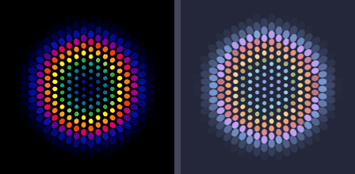
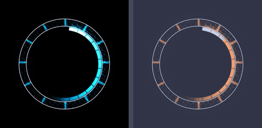
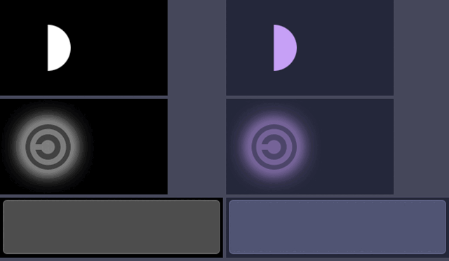
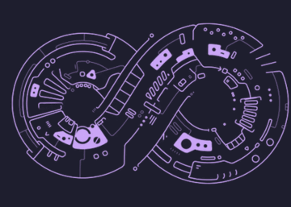
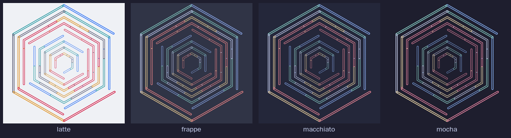
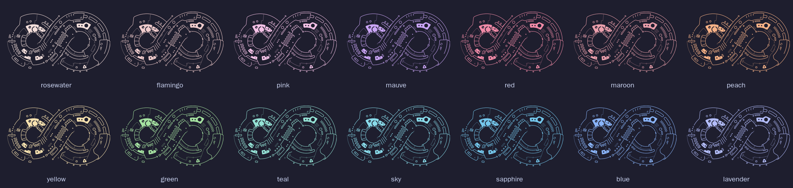

# plymouth-catppuccinizer

Recolour **any Plymouth boot theme** with [Catppuccin](https://catppuccin.com)
(Latte, Frappé, Macchiato, Mocha): a theme folder on your system (`script`,
`two-step`, `fade-throbber`…), or any of the 80 animations of
[adi1090x/plymouth-themes](https://github.com/adi1090x/plymouth-themes),
fetched by name.

The generator **detects the original colours automatically**, maps them to the
Catppuccin palette, and lets you **remap any colour by hand**. Anti-aliasing,
glow, shading and transparency are preserved.


## Quick start

Requires Python 3.11+ with `numpy` and `Pillow`, and `git`.

```bash
git clone https://github.com/erratos/plymouth-catppuccinizer.git
cd plymouth-catppuccinizer
python3 generate.py /usr/share/plymouth/themes/spinner -a mauve   # a theme you have
python3 generate.py --list                 # the 80 adi1090x themes
python3 generate.py rings_2 -f mocha       # one of them (fetched on demand)
./install.sh catppuccin-mocha-rings-2      # install + rebuild the initramfs
```

Prebuilt **hexa_retro** and **infinite_seal** (Mocha) themes are also available
from the [Releases](../../releases), see [Example themes](#example-themes).

## Examples

Left: original. Right: generated theme.

### Automatic detection: `angular` in Macchiato

```bash
python3 generate.py angular -f macchiato
```

```
angular: background #000000
  blue       #0129aa -> blue  (24%)
  orange     #ff8800 -> peach  (19%)
  blue-2     #0199c5 -> sky  (18%)
  yellow     #ffec01 -> yellow  (12%)
  purple     #2b08ac -> mauve  (11%)
  pink       #f00048 -> red  (11%)
  green      #67bb02 -> green  (6%)
```



Even a rainbow is split into hue clusters, each mapped to the closest Catppuccin colour.

### Manual mapping: `rings_2` with your own colours

```bash
python3 generate.py rings_2 -m pink=mauve green=peach blue=lavender
```


### Accent mode: `cyanide` in Frappé peach

```bash
python3 generate.py cyanide -f frappe -m cyan=accent -a peach
```



Colours mapped to `accent` produce one theme per accent passed with `-a`
(`-a all` gives the 14 of them). The white ring keeps `text`.

### Any theme folder: `glow` (two-step), with per-group mapping

```bash
python3 generate.py /usr/share/plymouth/themes/glow -f macchiato -a mauve \
    -m throbber.white=accent ui.white=lavender
```

```
Bizcom Glow [two-step]
  progress (33 images, transparent)
    white      #ffffff -> accent  (100%)
  throbber (20 images, transparent)
    white      #ffffff -> accent  (87%)
    yellow     #f9a905 -> yellow  (13%)
  ui (4 images, transparent)
    white      #ffffff -> lavender  (100%)
```



Each animation sequence and the UI pieces (password box, lock, bullets…) are
detected separately; `group.name=target` remaps a colour in one group only.
The two-step colours of the `.plymouth` file (background, progress bar) are
rewritten too.

## Example themes

These two are hand-tuned (see `configs/`) and published prebuilt in the
[Releases](../../releases), in Mocha.

| hexa_retro | infinite_seal (mauve) |
|:---:|:---:|
|  |  |
| `catppuccin-<flavor>-hexa-retro` | `catppuccin-<flavor>-infinite-seal-<accent>` |
| white → `text`, red → `red`, yellow → `yellow`, blue → `blue`, cyan → `teal` | white → accent |

hexa_retro in the four flavours:



infinite_seal, one theme per accent (Mocha):



Build them yourself, in any flavour:

```bash
python3 generate.py                          # both, Mocha, all accents (default)
python3 generate.py hexa_retro infinite_seal -f latte -a mauve blue
```

## The generator

### Supported themes

| Module | What is recoloured |
|---|---|
| `script` | all images, `Window.SetBackground…Color` calls (or added), white `Image.Text` colours |
| `two-step` | all images, `BackgroundStartColor`/`EndColor`, progress bar colours (alpha kept) |
| others (`fade-throbber`, `space-flares`…) | all images |

Other files (fonts, licences…) are copied, paths in the `.plymouth` file are
rewritten for the new theme name. Themes using `UseFirmwareBackground=true`
(e.g. CachyOS) keep showing the firmware logo screen behind the animation.

### Colour detection

The first time a theme is used, its colours are detected and saved to
`configs/<theme>.toml`, **per group of images**: each numbered sequence
(`animation-*`, `throbber-*`, `progress-*`…) and `ui` for the single images.

- a sequence with **a single colour** (white, cyan, orange…) is mapped to
  `accent`; a single-colour `ui` group goes to `text`;
- otherwise whites/grays go to `text` and each hue to the closest Catppuccin
  colour (red, peach, yellow, green, teal, sky, sapphire, blue, mauve, pink).

`python3 generate.py <theme> --detect` re-runs the detection and prints the mapping.

### Manual mapping

Use the colour names printed by the detection, optionally prefixed by the
group (`ui.white`), or a `#rrggbb` source colour:

```bash
python3 generate.py hexa_retro -m yellow=red white=lavender -s alt   # -s: name suffix
python3 generate.py owl -m white=accent -a mauve
python3 generate.py rings_2 -m '#32bcff=sky' --preview               # quick before/after image
```

`-m` applies to one run; edit `configs/<theme>.toml` for a permanent change.
Targets can be any Catppuccin colour (the 14 accents, `text`, `subtext1/0`,
`overlay2/1/0`, `surface2/1/0`, `base`, `mantle`, `crust`) or `accent`.

### Options

| Option | Default | Meaning |
|---|---|---|
| `THEME …` | `hexa_retro infinite_seal` | theme folder(s) or adi1090x theme name(s) |
| `-f, --flavor` | `mocha` | `latte`, `frappe`, `macchiato`, `mocha` or `all` |
| `-a, --accent` | `all` | accent(s) for colours mapped to `accent`, or `all` |
| `-m, --map` | | `[GROUP.]NAME=TARGET …` overrides for this run |
| `-s, --suffix` | | extra suffix for the theme names |
| `--bar` | auto | progress bar colour (`-status` variants, two-step bar) |
| `--no-status` | | skip the `-status` variants |
| `--detect` | | re-detect colours, overwrite the config, stop |
| `--preview` | | only render one before/after image per theme in `<out>/previews/` |
| `--list` | | list upstream themes (`[config]` = has a config) |
| `-o, --out` | `themes/` | output folder |
| `--src` | | local `adi1090x/plymouth-themes` checkout instead of fetching |

Output names: `catppuccin-<flavor>-<theme>[-<accent>][-<suffix>]`.

### `-status` variants

Themes built on adi1090x's script template also come as a `…-status`
variant that adds, under the animation:

- a thin **progress bar** (`surface0` track, accent fill) driven by the real
  boot progress reported by Plymouth (boot only, hidden on shutdown);
- the **last 4 services** started by systemd, newest in `subtext0`, older ones
  fading in `overlay1`, disappearing after 3 s of inactivity.

All themes use the flavour's `base` for the whole screen and `text` for
password prompts and messages.

## Installation

From the repository:

```bash
./install.sh catppuccin-mocha-hexa-retro-status
```

From a release archive:

```bash
tar xf catppuccin-mocha-infinite-seal-mauve.tar.gz
sudo cp -r catppuccin-mocha-infinite-seal-mauve /usr/share/plymouth/themes/
sudo plymouth-set-default-theme -R catppuccin-mocha-infinite-seal-mauve
```

`-R` rebuilds the initramfs (needed for the theme to show at boot). On KDE you
can also pick the theme in *System Settings → Boot Splash Screen* once copied.
Make sure `splash` is in your kernel command line and the `plymouth` hook is
enabled in your initramfs (e.g. `HOOKS=(… plymouth …)` in `/etc/mkinitcpio.conf`).

## Tools

| Script | What it does |
|---|---|
| `generate.py` | The generator. |
| `configs/*.toml` | Colour mappings per theme and image group (hand-tuned for the example themes, auto-created for others). |
| `extras.script` | Plymouth script code appended to the `-status` variants. |
| `install.sh <name\|folder>` | Installs a theme, sets it as default and rebuilds the initramfs. |
| `preview.sh [theme] [seconds]` | Shows a theme without rebooting, with simulated service messages. Always quits Plymouth at the end, even after Ctrl+C, and restores your previous default theme. Run it from a text console (Ctrl+Alt+F3) if nothing appears. |
| `boot-delay.sh <seconds\|off>` | Keeps the splash up to 15 s longer at boot, handy on fast machines to actually see the theme. Remember to turn it `off`. |

## How it works

- **Detection** (per image group): on ~24 images, the background is the most
  common border colour (or none for transparent images); bright content pixels are split into grays and hues, hue clusters are
  found from histogram peaks (plus extra centres for spread-out rainbows), and
  each cluster's brightest pixels give its source colour.
- **Recolouring**: every pixel is modelled as `background + t × (source −
  background)`. For each pixel the source colour and intensity `t` that explain
  it best are found, then it is rebuilt as `base + t × (target − base)`.
  Single-colour themes are stored as indexed PNGs whose palette is the exact
  `base → target` ramp (lossless). Transparent images keep their alpha channel.
- **Limits**: where two colours blend (overlapping lines, gradients between
  hues) a pixel is attached to one of them; very photographic themes keep their
  shapes but lose subtle hue variations.

## Credits & licence

- Original animations and scripts: [Aditya Shakya (@adi1090x)](https://github.com/adi1090x/plymouth-themes), GPL-3.0.
- Colours: [Catppuccin](https://github.com/catppuccin/catppuccin).
- This project is released under the GPL-3.0, like the original themes.
  Not affiliated with the official [catppuccin/plymouth](https://github.com/catppuccin/plymouth) port.
