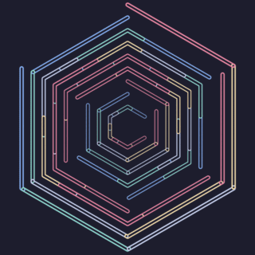

# catppuccin-adi1090x-plymouth

[Catppuccin](https://catppuccin.com) adaptations (Latte, Frappé, Macchiato,
Mocha) of two Plymouth boot animations from [adi1090x/plymouth-themes](https://github.com/adi1090x/plymouth-themes):
**hexa_retro** and **infinite_seal**.

| hexa_retro | infinite_seal (mauve) |
|:---:|:---:|
|  |  |

### Four flavours


### infinite_seal: one theme per accent (Mocha shown)


## Themes

| Theme | Colours |
|---|---|
| `catppuccin-<flavor>-hexa-retro` | white → `text`, red → `red`, yellow → `yellow`, blue → `blue`, cyan → `teal` |
| `catppuccin-<flavor>-infinite-seal-<accent>` | white → accent (rosewater, flamingo, pink, mauve, red, maroon, peach, yellow, green, teal, sky, sapphire, blue, lavender) |

`<flavor>` is `latte`, `frappe`, `macchiato` or `mocha`. All themes use the
flavour's `base` for the whole screen and `text` for password prompts and messages.
Prebuilt [releases](../../releases) contain the Mocha themes; build any other
flavour/accent combination from source (see below).

### `-status` variants

Every theme also comes as a `…-status` variant that adds, under the animation:

- a thin **progress bar** (`surface0` track, accent fill) driven by the
  real boot progress reported by Plymouth (boot only, hidden on shutdown);
- the **last 4 services** started by systemd, newest in `subtext0`, older ones
  fading in `overlay1`, disappearing after 3 s of inactivity.

## Installation

### From a release

Download the archive of the theme you want from the
[Releases](../../releases) page, then:

```bash
tar xf catppuccin-mocha-infinite-seal-mauve.tar.gz
./install.sh ./catppuccin-mocha-infinite-seal-mauve
```

Or without the script:

```bash
sudo cp -r catppuccin-mocha-infinite-seal-mauve /usr/share/plymouth/themes/
sudo plymouth-set-default-theme -R catppuccin-mocha-infinite-seal-mauve
```

`-R` rebuilds the initramfs (needed for the theme to show at boot). On KDE you
can also pick the theme in *System Settings → Boot Splash Screen* once copied.

Make sure `splash` is in your kernel command line and the `plymouth` hook is
enabled in your initramfs (e.g. `HOOKS=(… plymouth …)` in `/etc/mkinitcpio.conf`).

### From source

Requires Python 3 with `numpy` and `Pillow`, and `git`.

```bash
git clone https://github.com/erratos/catppuccin-adi1090x-plymouth.git
cd catppuccin-adi1090x-plymouth
python3 generate.py          # fetches the upstream themes, writes themes/
./install.sh catppuccin-mocha-hexa-retro-status
```

Pick the flavour(s) and accent(s) you want:

```bash
python3 generate.py -f macchiato -a mauve            # macchiato hexa_retro + mauve seal
python3 generate.py -f latte frappe -a pink blue     # several at once
python3 generate.py -f all -a all                    # everything: 120 themes, ~2.3 GB
python3 generate.py -f mocha -a teal -t seal --no-status
```

| Option | Default | Meaning |
|---|---|---|
| `-f, --flavor` | `mocha` | `latte`, `frappe`, `macchiato`, `mocha` or `all` (several allowed) |
| `-a, --accent` | `all` | infinite_seal accent(s) or `all` |
| `-t, --theme` | `hexa seal` | which animations to build |
| `--hexa-bar` | `blue` | progress bar accent of `hexa-retro-status` |
| `--no-status` | | skip the `-status` variants |
| `-o, --out` | `themes/` | output folder |
| `--src` | fetched into `upstream/` | local copy of `adi1090x/plymouth-themes/pack_3` |

## Tools

| Script | What it does |
|---|---|
| `generate.py` | Fetches the two upstream themes and generates the chosen flavours/accents in `themes/`. Palettes and colour mapping live at the top of the file. |
| `extras.script` | Plymouth script code appended to the `-status` variants (progress bar + service list). |
| `install.sh <name\|folder>` | Installs a theme, sets it as default and rebuilds the initramfs. |
| `preview.sh [theme] [seconds]` | Shows the theme without rebooting, with simulated service messages. Always quits Plymouth at the end, even after Ctrl+C, and restores your previous default theme. Run it from a text console (Ctrl+Alt+F3) if nothing appears. |
| `boot-delay.sh <seconds\|off>` | Keeps the splash up to 15 s longer at boot, handy on fast machines to actually see the theme. Remember to turn it `off`. |

## How the recolouring works

- **infinite_seal** is white on black: each pixel's intensity becomes a blend
  between the flavour's `base` and the accent, stored as an indexed PNG whose palette
  is that exact gradient (lossless, same size as the original).
- **hexa_retro** has five neon colours over black: each pixel is matched to the
  nearest original colour and its intensity, then rebuilt with the flavour's colour
  over `base`, so anti-aliasing and glow are preserved.

## Credits & licence

- Original animations and scripts: [Aditya Shakya (@adi1090x)](https://github.com/adi1090x/plymouth-themes), GPL-3.0.
- Colours: [Catppuccin](https://github.com/catppuccin/catppuccin).
- This project is released under the GPL-3.0, like the original themes.
  Not affiliated with the official [catppuccin/plymouth](https://github.com/catppuccin/plymouth) port.
