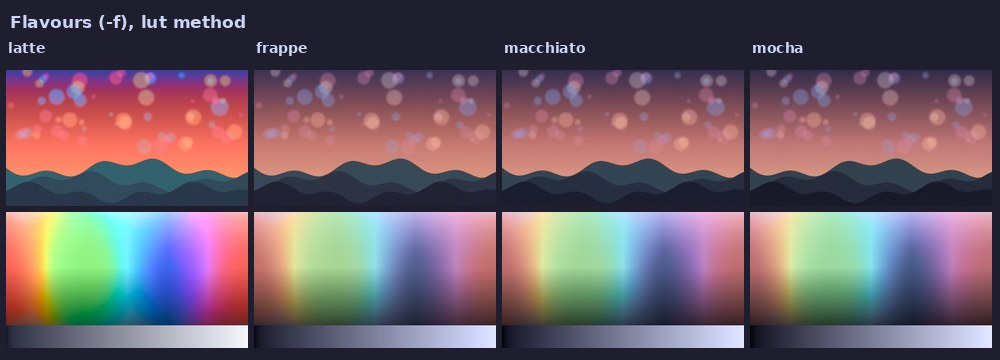

# Colours and mapping

[← Back to the README](../README.md) · [Getting started](getting-started.md)

What the options shared by every target mean, and how colours are chosen.

## Shared options

| Option | Meaning |
|---|---|
| `-f, --flavor` | `latte`, `frappe`, `macchiato`, `mocha` (default) or `all`; several can be given |
| `-a, --accent` | accent colour(s) used for colours mapped to `accent`, or `all` (the 14 accents) |
| `-m, --map` | `NAME=TARGET …`: change where a source colour goes; repeated `-m` add up |
| `--preview` | only render before/after images in `<out>/previews/`, nothing else |
| `-o, --out` | output folder (`themes/`, `images/` or `luts/` by default) |

## Flavours



Latte is the light flavour: its palette spans from dark text to a light
background and its accents are more saturated, so results stay brighter and
more colourful. Frappé, Macchiato and Mocha are progressively darker and
softer.

## Colour targets

A colour can be sent to any Catppuccin colour of the flavour:

- the 14 accents: `rosewater`, `flamingo`, `pink`, `mauve`, `red`, `maroon`,
  `peach`, `yellow`, `green`, `teal`, `sky`, `sapphire`, `blue`, `lavender`;
- the neutrals, from light to dark (in Mocha): `text`, `subtext1`, `subtext0`,
  `overlay2`, `overlay1`, `overlay0`, `surface2`, `surface1`, `surface0`,
  `base`, `mantle`, `crust`;
- `accent`: whatever is passed with `-a`. One output is produced per accent,
  so `-a all` gives 14 variants.

## Automatic detection

The original colours are detected and given a name (`white`, `blue`,
`blue-2`, `orange`…). The tool prints them with the colour each one goes to:

```
angular: background #000000
  blue       #0129aa -> blue  (24%)
  orange     #ff8800 -> peach  (19%)
  ...
```

In short: whites and grays go to `text` (or the neutral ramp, by lightness),
each hue to the closest Catppuccin colour, and a design made of a single
colour goes to `accent`. Anti-aliasing, glow, shading and transparency are
preserved.

## Manual mapping

`-m` takes the names printed by the detection, or a `#rrggbb` source colour:

```bash
catppuccinize plymouth rings_2 -m pink=mauve green=peach blue=lavender
catppuccinize image logo.svg -m '#3daee9=peach'
catppuccinize plymouth /usr/share/plymouth/themes/glow \
    -m throbber.white=accent ui.white=lavender      # per group of images (Plymouth)
```

Quote `#…` values in the shell. Repeated `-m` options add up instead of the
last one winning.

## How it works

- **Detection** (per image group): on ~24 images, the background is the most
  common border colour (or none for transparent images); bright content pixels
  are split into grays and hues, hue clusters are found from histogram peaks
  (plus extra centres for spread-out rainbows), and each cluster's brightest
  pixels give its source colour.
- **Recolouring**: every pixel is modelled as `background + t × (source −
  background)`. For each pixel the source colour and intensity `t` that explain
  it best are found, then it is rebuilt as `base + t × (target − base)`.
  Single-colour themes are stored as indexed PNGs whose palette is the exact
  `base → target` ramp (lossless). Transparent images keep their alpha channel.
- **Images, LUT method**: a 33³ colour look-up table built in Oklab. Each
  colour's lightness is mapped onto the flavour's neutral ramp (`crust` →
  `text`) and blended with the original (`--keep-lum`); its hue goes to a soft
  mix of the nearest accents (`--smooth`), in proportion to its original
  chroma, so grays stay neutral and saturated colours become Catppuccin accents.
- **lutgen method**: `lutgen generate` builds a Hald CLUT from the flavour's 26
  colours with the chosen algorithm. catppuccinizer reads it back as a cube and
  applies it with trilinear interpolation, like its own LUT. The table is
  generated once per flavour and set of options.
- **Limits**: where two colours blend (overlapping lines, gradients between
  hues) a pixel is attached to one of them; very photographic themes keep their
  shapes but lose subtle hue variations.
