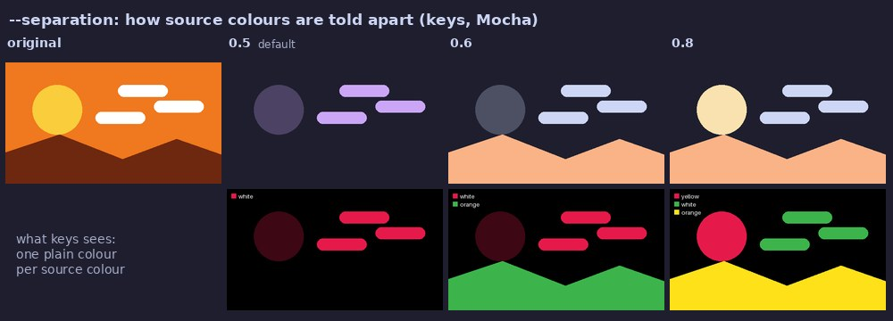

# Colours and mapping

[← Back to the README](../README.md) · [Getting started](getting-started.md)

What the options shared by every target mean, and how colours are chosen.

## Shared options

| Option | Meaning |
|---|---|
| `-f, --flavor` | `latte`, `frappe`, `macchiato`, `mocha` (default) or `all`; several can be given |
| `-a, --accent` | accent colour(s) used for colours mapped to `accent`, or `all` (the 14 accents, the default: one result per accent for what uses one; `--install` / `--apply` / `--test` need a single one); `PART=ACCENT` for one [part](#parts-an-accent-each) |
| `-m, --map` | `NAME=TARGET …`: change where a source colour goes; repeated `-m` add up |
| `--preview` | only render before/after images in `<out>/previews/`, nothing else |
| `-o, --out` | output folder (`themes/`, `images/` or `luts/` by default) |
| `-s, --suffix` | extra word at the end of the output names (lowercase letters, digits, `-`) |

## Parts: an accent each

A result is made of parts, each recoloured on its own:

| Target | Parts (main one first) |
|---|---|
| `limine` | `menu` (title and highlighted help in the accent, text in the flavour's `text`), `wallpaper` |
| `plymouth` | each group of images (`animation`, `throbber`, `progress`… biggest first, `ui`), `bar` (the progress bar, when the theme has one) |
| `ksplash` | `vector` (QML / SVG colours), `animations` (with the preview when it is a still of one), `images` |
| `image` | each image, by its file name (`photo` for `photo.jpg`) |

`--colours` lists them, each with what uses the accent. A part takes the
accents given plainly (one result each); `PART=ACCENT` gives it its own,
the same in every result:

```bash
catppuccinize limine --wallpaper wall.png -a mauve wallpaper=peach      # mauve menu, peach wallpaper
catppuccinize limine --wallpaper wall.png -a mauve blue wallpaper=peach  # two results, both peach walls
catppuccinize plymouth glow -a mauve throbber=green bar=red
```

The output name carries the accent of the main part that uses one, then
`-<part>-<accent>` for each other part whose accent differs:
`catppuccin-mocha-limine-mauve-wallpaper-peach`. A part that does not use the
accent (a wallpaper recoloured with `lut`) keeps no accent of its own, and the
command says so. The progress bar of Plymouth follows the accent; with
nothing mapped to the accent it takes the theme's main colour.

## Output names

Every command names what it writes the same way:

```
catppuccin-<flavor>-<source>[-<accent>][-<suffix>]
```

`<source>` is what was recoloured (image file name, theme, splash screen,
`limine`, `lut`…) in lowercase letters, digits and `-` (`My Wall.jpg` →
`my-wall`). The accent only appears when the output uses it, so a photo
recoloured with the `lut` method gives one file per flavour. Examples:
`catppuccin-mocha-wall.jpg`, `catppuccin-mocha-rings-2-mauve/`,
`catppuccin-mocha-limine-peach/`, `catppuccin-mocha-lut.cube`.

`--names` lists what a command would write, without writing anything, and
marks what already exists (a build replaces it); `--json` for JSON:

```bash
catppuccinize image ~/Pictures/walls -f latte mocha --names
```

It analyses what it must to know whether the accent is used (like
`--colours`). The GUI shows the same list under the *Command* box.

## Flavours


Latte is the light flavour: its palette spans from dark text to a light
background and its accents are more saturated, so results stay brighter and
more colourful. Frappé, Macchiato and Mocha are progressively darker and
softer.

## Colour targets

A colour can be sent to any Catppuccin colour of the flavour:

- the 14 accents: `rosewater`, `flamingo`, `pink`, `mauve`, `red`, `maroon`,
  `peach`, `yellow`, `green`, `teal`, `sky`, `sapphire`, `blue`, `lavender`;
- the neutrals, from light to dark (in Mocha): `text`, `subtext1`, `subtext0`,
  `overlay2`, `overlay1`, `overlay0`, `surface2`, `surface1`, `surface0`,
  `base`, `mantle`, `crust`;
- `accent`: whatever is passed with `-a`. One output is produced per accent,
  so `-a all` gives 14 variants.

## Which method, and does the accent count?

Each target recolours in its own way, so `-a` and `-m` do not always have an
effect:

| Target | Method (default) | Why | Accent (`-a`) used | `--map` (`-m`) used |
|---|---|---|---|---|
| `plymouth` | always `keys` (no `--method`) | boot themes are flat art; colours are detected at each run | when a colour goes to `accent` (single-colour themes by default); the progress bar follows it (`-a bar=ACCENT` for its own) | yes |
| `image` | `auto`: `keys` or `lut` | `keys` when the detected colours rebuild the image (fit error under 6), a plain background covers at least 35 % of it and its edges are crisp; `lut` otherwise. `auto` never picks `lut-accent` or `lutgen` | `keys`: when a colour goes to `accent` (typically a single-colour design). `lut-accent`: the dominant hue. `lut`, `lutgen`: never | `keys` only |
| `image` (SVG) | vector, colours replaced in the file | nothing is rasterised | when a colour goes to `accent` (the most used saturated colour, by default) | yes |
| `limine` | menu: fixed colours; wallpaper: `auto`, like `image` | | always, for the menu (branding and highlighted help); the wallpaper as for `image` | wallpaper, with `keys` |
| `ksplash` | QML / SVG colours replaced; images `auto`, like `image`; animations `keys` | | when a QML / SVG colour or an image recoloured with `keys` goes to `accent` | everywhere, except images recoloured with a LUT |
| `lut` | `lut` (or `lutgen`; `keys`, `lut-accent` are refused) | it writes the LUT itself, without an image to find a dominant hue in | never | never |

When the accent is not used, a single result is written per flavour (no
`-<accent>` in its name). If you passed `-a` and it has no effect, the command
says so:

```
photo.jpg: lut (fit error 44.5, background 0%, sharpness 0.87)
  note: accent ignored by the lut method (--method lut-accent uses it)
logo.png: keys (fit error 0.0, background 94%, sharpness 0.99)
  ...
  note: accent ignored as no colour is mapped to accent (map one with -m NAME=accent)
```

`--map` is reported the same way (`note: --map is ignored by the lut method`).
To give the accent to a photo, use `--method lut-accent` (its dominant hue
takes the accent); on flat art, `--method keys` and map a colour to it
(`-m white=accent`). The [graphical interface](gui.md) dims the accents when
the chosen method cannot use them.

## Automatic detection

The original colours are detected and given a name (`white`, `blue`,
`blue-2`, `orange`…). The tool prints them with the colour each one goes to:

```
angular: background #000000
  blue       #0129aa -> blue  (24%)
  orange     #ff8800 -> peach  (19%)
  ...
```

In short: whites and grays go to `text` (or the neutral ramp, by lightness),
each hue to the closest Catppuccin colour, and a design made of a single
colour goes to `accent`. Anti-aliasing, glow, shading and transparency are
preserved.

## Separating colours

An element that has no source colour of its own is rebuilt from its
neighbour's, with little intensity: it fades into the background or takes the
wrong colour. Typically a yellow sun on an orange sky, next to white clouds
that are far more contrasted, or a shape darker than the background.
`--separation` (0 to 1, `keys` only) sets how the colours are told apart:

- higher keeps faint and small colours apart and, above the default (`0.5`),
  also finds colours **darker than the background**;
- lower merges close colours into fewer source colours.



The default is the detection as it has always been. With `--preview`, a
picture recoloured with `keys` gets a third panel that shows what `keys` sees:
each source colour in its own plain colour (named in the corner), as bright as
the pixel is made of it, black for the background. A part shown in its
neighbour's colour, or dark, has no colour of its own. `--colours` lists the
colours of the chosen setting. With `auto`, more colours also rebuild a
picture better, so `keys` may be picked where `lut` was.

### Adding a missing colour

Instead of (or as well as) raising the setting, add the colour yourself: a
`#rrggbb` that `-m` does not find among the source colours becomes a source
colour of its own.

```bash
catppuccinize image poster.png --method keys -m '#fad23c=yellow'
```

In the [graphical interface](gui.md#parts-and-remapping-a-colour), click it in the
original image of a preview.

## Manual mapping

To see the names first, `--colours` lists the colours `-m` can remap and
exits, without writing anything (no output folder):

```bash
catppuccinize plymouth /usr/share/plymouth/themes/glow --colours
```

```
glow / progress: keys, background transparent (33 images)
    progress.white  #ffffff -> accent  (100%)
glow / throbber: keys, background transparent (20 images)
    throbber.white   #ffffff -> text  (87%)
    throbber.yellow  #f9a905 -> yellow  (13%)
glow / ui: keys, background transparent (4 images)
    ui.white  #ffffff -> text  (100%)
```

Each line is a name `-m` accepts (with its group when there are several),
the source colour, its current target (after the `-m` already given) and its
share. A source that cannot be remapped says why (`photo.jpg: lut (no remap:
the lut method uses no source colours)`); with `--method auto`, the method
shown is the one a run would use. `--json` prints the same list as JSON.
`lut` has no source colours, so it has no `--colours`.

`-m` takes those names, or a `#rrggbb` source colour:

```bash
catppuccinize plymouth rings_2 -m pink=mauve green=peach blue=lavender
catppuccinize image logo.svg -m '#3daee9=peach'
catppuccinize plymouth /usr/share/plymouth/themes/glow \
    -m throbber.white=accent ui.white=lavender      # per group of images (Plymouth)
```

Quote `#…` values in the shell. Repeated `-m` options add up instead of the
last one winning.

## How it works

- **Detection** (per image group): on ~24 images, the background is the most
  common border colour (or none for transparent images); the pixels far enough
  from it (half the distance of the most contrasted ones, by default) are split
  into grays and hues, hue clusters are found from histogram peaks (plus extra
  centres for spread-out rainbows), and each cluster's brightest pixels give
  its source colour. A colour must cover a few percent of these pixels, and at
  most 8 are kept; `--separation` moves all these thresholds together.
- **Recolouring**: every pixel is modelled as `background + t × (source −
  background)`. For each pixel the source colour and intensity `t` that explain
  it best are found, then it is rebuilt as `base + t × (target − base)`.
  Single-colour themes are stored as indexed PNGs whose palette is the exact
  `base → target` ramp (lossless). Transparent images keep their alpha channel.
- **Images, LUT method**: a 33³ colour look-up table built in Oklab. Each
  colour's lightness is mapped onto the flavour's neutral ramp (`crust` →
  `text`) and blended with the original (`--keep-lum`); its hue goes to a soft
  mix of the nearest accents (`--smooth`), in proportion to its original
  chroma, so grays stay neutral and saturated colours become Catppuccin accents.
- **lutgen method**: `lutgen generate` builds a Hald CLUT from the flavour's 26
  colours with the chosen algorithm. catppuccinizer reads it back as a cube and
  applies it with trilinear interpolation, like its own LUT. The table is
  generated once per flavour and set of options.
- **Limits**: where two colours blend (overlapping lines, gradients between
  hues) a pixel is attached to one of them; very photographic themes keep their
  shapes but lose subtle hue variations. A faint, small or darker element can
  be missed: see [Separating colours](#separating-colours).
