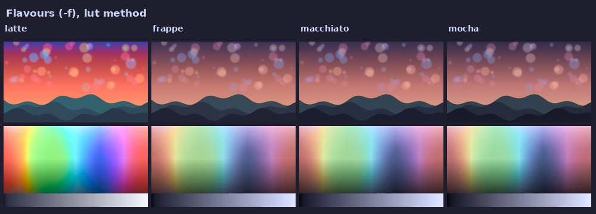

# Getting started

[← Back to the README](../README.md)

A ten-minute tour: install the tool, recolour a wallpaper, then try a boot
splash without rebooting. Nothing here touches your system until you ask for
it with `--install` or `--apply`.

## 1. Install

You need Python 3.11+ (with `numpy` and `Pillow`, installed automatically by
pipx) and `git`.

```bash
pipx install git+https://github.com/erratos/catppuccinizer.git
```

No pipx? `pip install --user git+https://github.com/erratos/catppuccinizer.git`,
or clone the repository and run `./catppuccinize` from it.

Check that it works:

```bash
catppuccinize --help
```

## 2. Two words to know

[Catppuccin](https://catppuccin.com) comes in four **flavours**, from light to
dark: `latte`, `frappe`, `macchiato`, `mocha`. Pick one with `-f` (default:
`mocha`).

Each flavour has 14 **accent** colours (`mauve`, `blue`, `peach`, `green`…).
Pick the one you like with `-a`.



That is all you need for most commands.

## 3. Recolour a wallpaper

```bash
catppuccinize image ~/Pictures/wall.jpg
```

The result lands in `./wallpapers/wall-catppuccin-mocha.jpg`. The tool decides
on its own whether your image is flat art or a photo, and treats it
accordingly.

Want to compare before choosing? `--preview` only writes a side-by-side image,
and `-f all` tries the four flavours at once:

```bash
catppuccinize image ~/Pictures/wall.jpg -f all --preview
```

Look in `./wallpapers/previews/`.

## 4. Try a boot splash (Plymouth)

Plymouth draws the animation shown while your computer boots. The tool can
fetch 80 ready-made animations by name (list them with
`catppuccinize plymouth --list`) and recolour them:

```bash
catppuccinize plymouth rings_2 -a mauve --test
```

`--test` shows the result for 10 seconds, right now, without rebooting. If you
like it, install it:

```bash
catppuccinize plymouth rings_2 -a mauve --install
```

It asks for your password (the theme goes into `/usr/share/plymouth/themes/`)
and makes it the default. You will see it at the next boot.

## 5. Not happy with a colour?

When it recolours something, the tool prints the colours it found and where
each one goes:

```
Rings 2 [script]
  progress (270 images, background #000000)
    blue       #32bcff -> sapphire  (46%)
    green      #8cff4a -> green  (32%)
    pink       #ff42a5 -> pink  (22%)
```

Use those names with `-m` to send a colour elsewhere:

```bash
catppuccinize plymouth rings_2 -m pink=mauve green=peach blue=lavender --test
```

The list of colour names you can use is in [Colours and mapping](colours.md).

## Where to go next

- [Plymouth](plymouth.md): any theme folder, `-status` variants, installing by hand;
- [Wallpapers](wallpapers.md): methods for photos vs flat art, SVG, lutgen;
- [Limine](limine.md): boot menu colours;
- [KDE splash screen](ksplash.md): the splash shown after login;
- [LUT export](lut.md): use the same colours in ffmpeg, GIMP, OBS…;
- [Colours and mapping](colours.md): every colour name and how detection works.

Every command also has its own help: `catppuccinize <target> --help`.
