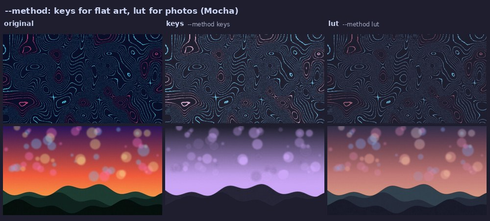
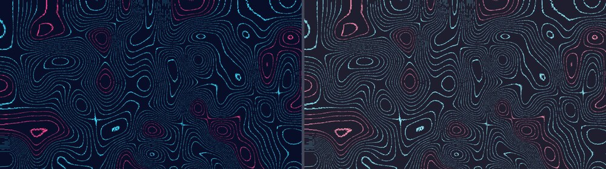
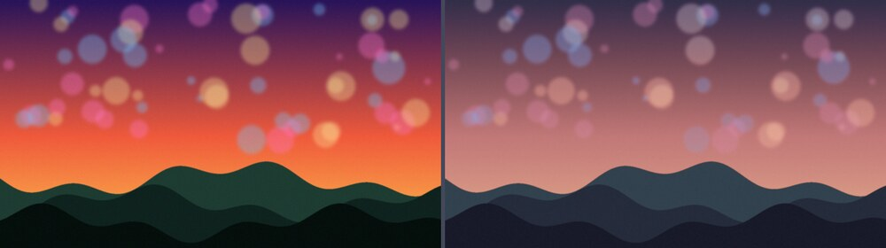
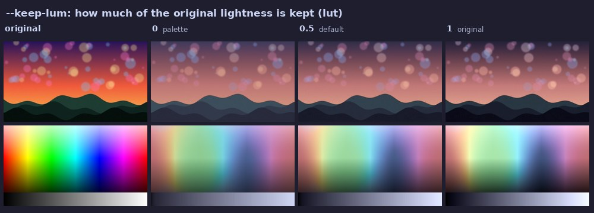
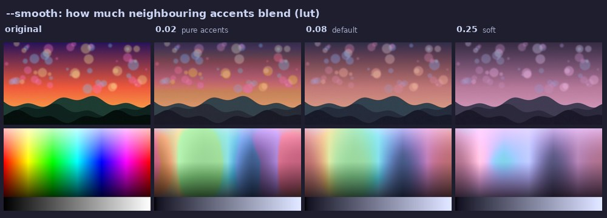
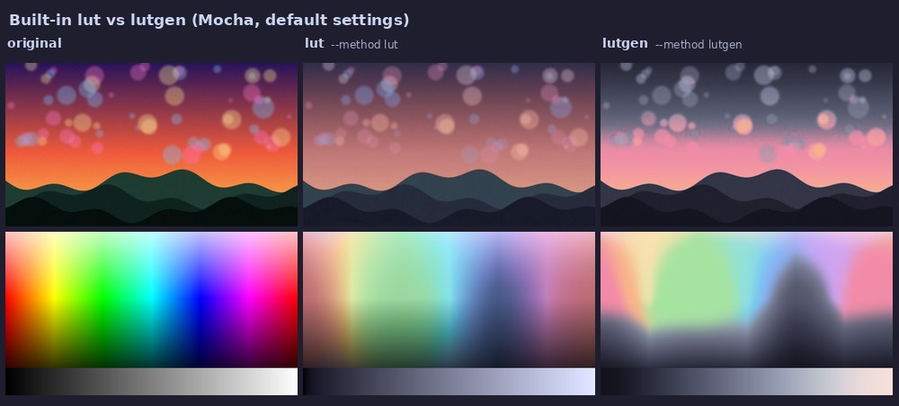
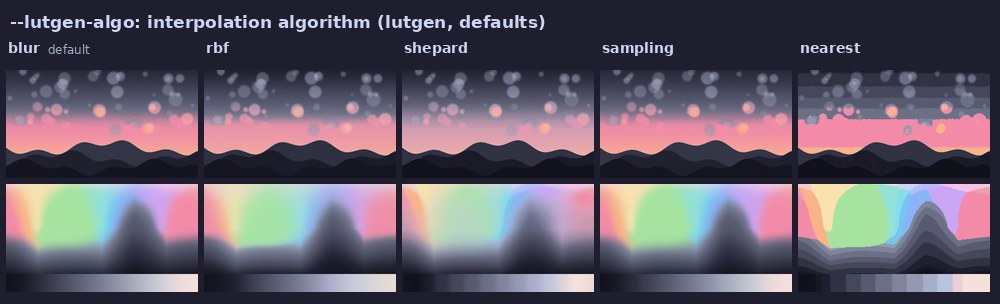
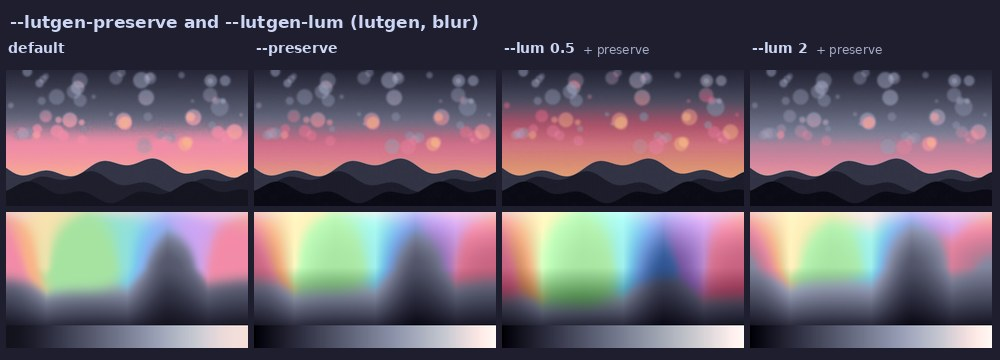
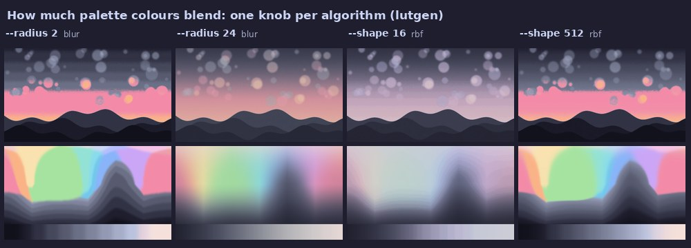

# Images

[← Back to the README](../README.md) · [Getting started](getting-started.md)

Recolours any picture: wallpapers, photos, flat art, SVG logos and icons.

```bash
catppuccinize image wall.png                     # Mocha, method chosen automatically
catppuccinize image ~/Pictures/walls -f all      # a whole folder, four flavours
catppuccinize image photo.jpg --method lut --keep-lum 0.7 --preview
catppuccinize image logo.svg -m blue=lavender    # SVG stays SVG
catppuccinize image photo.jpg --method lutgen --lutgen-algo rbf   # LUT made by lutgen
catppuccinize image --list                       # the wallpapers installed on the system
```

Output: `images/catppuccin-<flavor>-<name>[-<accent>][-<suffix>].png` (JPEG/WebP
photos keep their format; see [output names](colours.md#output-names)).
`--preview` writes before/after images into `images/previews/` instead. There is
nothing to install: nothing is written outside the output folder.

## Reading the comparison images

The images on this page show the same two pictures through several settings:
a **sunset scene** on top and a **colour chart** below it (every hue from left
to right, light at the top to dark at the bottom, and a gray ramp along the
bottom edge). The chart shows where each kind of colour ends up. They are
built by `python3 tools/doc_previews.py`.

## Methods

Two methods, picked automatically (`--method auto|keys|lut`), plus an optional
third one (`lutgen`) that is only used when asked for:

| Method | For | How |
|---|---|---|
| `keys` | flat art: line art, logos, neon on a plain background | the Plymouth method: source colours detected, `--map` and `accent` work |
| `lut` | photos, paintings, gradients | colour look-up table: lightness mapped onto the flavour's neutrals, hues pulled to the nearest accents |
| `lutgen` | photos, as an alternative to `lut` | colour look-up table generated by [lutgen](#lutgen-method) from the 26 colours of the flavour |

`auto` uses `keys` when the detected colours rebuild the image almost exactly,
a plain background covers a good part of it and its edges are crisp, `lut`
otherwise. The accent only matters with `keys`, when a colour goes to `accent`
(see [which method, and does the accent count?](colours.md#which-method-and-does-the-accent-count)).



`keys` is exact on flat art (top) but breaks on a photo (bottom): it knows only
a handful of source colours, so a gradient sky collapses into one accent. `lut`
works on anything, at the cost of slightly duller flat art.

**Flat art** (`keys`, auto-detected):



**Photo-like** (`lut`):



## Tuning the `lut` method

Two knobs change the look; try them with `--preview`.

**`--keep-lum`** (0 to 1, default 0.5): lightness of the result. At `0` every
colour takes the lightness of the palette's neutrals (`crust` → `text`): low
contrast, very Catppuccin. At `1` the original lightness is kept: deep blacks
and bright highlights, more contrast.



**`--smooth`** (default 0.08): how far a colour looks for accents. Small values
snap each hue to its single closest accent (distinct bands of green, blue,
pink in the chart); large values blend many accents together, towards a
pastel, almost uniform tint.



## SVG / SVGZ

SVG files stay vector: the colours written in the file (`fill`, `stroke`,
`stop-color`…) are mapped to Catppuccin roles and replaced, nothing is
rasterised, so the result scales like the original. `-m` works as for images
(names or `#rrggbb`); `--preview` renders a before/after PNG with
`rsvg-convert` when it is installed.

## Options

| Option | Default | Meaning |
|---|---|---|
| `IMAGE …` | | files or folders (searched recursively) |
| `-f, --flavor` | `mocha` | `latte`, `frappe`, `macchiato`, `mocha` or `all` |
| `--method` | `auto` | `keys`, `lut`, `lutgen` or `auto` (never picks `lutgen`) |
| `--keep-lum` | `0.5` | lut: 0 = palette lightness, 1 = original lightness |
| `--smooth` | `0.08` | lut: accent blend radius; smaller = purer accents |
| `-a` | `mauve` | accent for colours mapped to `accent` (keys) |
| `-m, --map` | | `NAME=TARGET …` overrides (keys, SVG) |
| `--preview` | | only render before/after images in `<out>/previews/` |
| `--list` | | list the wallpapers of `/usr/share/wallpapers`, `/usr/share/backgrounds`, `~/.local/share/wallpapers` |
| `--names` | | only list the files and folders the build would write (existing ones marked); `--json` for JSON |
| `--colours` | | only list the colours `-m` can remap, and the method each image would get ([details](colours.md#manual-mapping)); `--json` for JSON |
| `-s, --suffix` | | extra word at the end of the file names |
| `-o, --out` | `images/` | output folder |
| `--lutgen-*` | | see [lutgen method](#lutgen-method) |

## lutgen method

`--method lutgen` asks [lutgen](https://github.com/ozwaldorf/lutgen-rs) (MIT,
Rust) for a Hald CLUT built from the 26 colours of the flavour, then applies it
like the built-in LUT (transparency, JPEG/WebP output, animations and the
`limine` / `ksplash` targets work the same). It is never chosen by `auto`.

```bash
cargo install --locked lutgen-cli     # or the AUR package: paru -S lutgen-bin
```

The binary is looked up in `$CATPPUCCINIZER_LUTGEN`, then `$PATH`, then
`~/.cargo/bin` (also the invoking user's under `sudo`).

**`lut` or `lutgen`?** The built-in `lut` treats neutrals and accents
separately: lightness follows the `crust` → `text` ramp and only saturated
colours take an accent, so grays stay gray and violets stay violet. lutgen
interpolates towards the closest palette colours in colour space, without that
distinction. Dark or muted colours then often land on the gray `surface` /
`overlay` colours, which gives a moodier, less colourful result. Only bright,
saturated colours keep an accent. Try both with `--preview`.



In the chart: `lut` keeps a smooth rainbow of Catppuccin accents and a clean
neutral gray ramp; `lutgen` forms large patches of single palette colours and
pulls dark or muted colours (the deep blues, the shadows of the sky) to gray.
On the scene, the sky turns gray-blue with lutgen instead of staying violet.

### lutgen options

**`--lutgen-algo`**: the interpolation. `blur`, `rbf`, `shepard` and
`sampling` give similar soft results with small differences in how colours
blend; `nearest` does not interpolate at all, every colour snaps to one palette
colour, which gives a flat, posterised look (visible bands in the sky).



**`--lutgen-preserve`** keeps the original lightness after interpolation (like
`--keep-lum 1` for `lut`); **`--lutgen-lum`** changes how much lightness counts
when matching colours: below 1 colours find a colourful match more easily
(the deep blue stays blue), above 1 they go to gray more easily.



**Blending**: each algorithm has its own knob for how much neighbouring
palette colours mix. With `blur`, a small `--lutgen-radius` gives hard
transitions (close to `nearest`) and a large one washes colours out; with
`rbf`, `--lutgen-shape` works the other way round (small = blended, large =
hard).



| Option | Default | Algorithms | Meaning |
|---|---|---|---|
| `--lutgen-algo` | `blur` | | `blur` (Gaussian blur, lutgen's default), `rbf` (Gaussian RBF), `shepard` (Shepard's method, inverse distance), `sampling` (Gaussian sampling, slow), `nearest` (no interpolation: flat, posterised) |
| `--lutgen-level` | `10` | all | Hald CLUT level 2–16: the table has level² points per axis |
| `--lutgen-preserve` | off | all | keep the original lightness after interpolation |
| `--lutgen-lum` | `1` | all | lightness weight when matching colours: below 1 favours colourful matches, above 1 neutral ones; usually with `--lutgen-preserve` |
| `--lutgen-radius` | `8` | `blur` | blur radius (sigma): larger = more blending between palette colours |
| `--lutgen-shape` | `128` | `rbf` | bigger = less blending (closer to `nearest`) |
| `--lutgen-nearest` | `16` | `rbf`, `shepard` | number of nearest palette colours used, `0` = all |
| `--lutgen-power` | `4` | `shepard` | inverse distance power: bigger = sharper transitions |
| `--lutgen-mean` | `0` | `sampling` | mean of the noise added per iteration |
| `--lutgen-std-dev` | `20` | `sampling` | standard deviation of that noise: larger = more blending |
| `--lutgen-iterations` | `512` | `sampling` | noise iterations per colour (slower, smoother) |
| `--lutgen-seed` | `42080085` | `sampling` | noise seed (results are reproducible) |

Defaults are lutgen's own. An option that does not belong to the chosen
algorithm is an error (e.g. `--lutgen-radius` with `--lutgen-algo rbf`).
