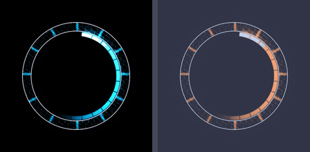
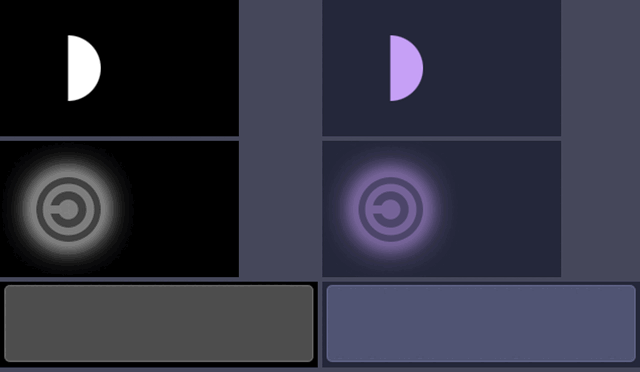

# Plymouth

[← Back to the README](../README.md) · [Getting started](getting-started.md)

Recolours a Plymouth boot splash theme: the one in use by default, any
installed theme by name, or any theme folder (`script`, `two-step`,
`fade-throbber`…), such as one [downloaded](#getting-themes) from the 80
animations of [adi1090x/plymouth-themes](https://github.com/adi1090x/plymouth-themes).

```bash
catppuccinize plymouth -a mauve                        # the theme in use
catppuccinize plymouth spinner -a mauve                # an installed theme, by name
catppuccinize plymouth --list                          # installed themes, and where to get more
catppuccinize plymouth $ADI/pack_4/rings_2 -a mauve    # a downloaded theme folder ($ADI: below)
sudo catppuccinize plymouth spinner -a mauve --test    # build it and show it, no reboot
sudo catppuccinize plymouth spinner -a mauve --apply   # install, make it the default
sudo catppuccinize plymouth --restore                  # back to your previous theme
```

## Getting themes

Three places to take a theme from (the GUI has a button for each):

- **System locations**: the themes installed in `/usr/share/plymouth/themes`,
  given by name (`spinner`); `--list` shows them, `*` before the one in use.
- **Any folder** holding a `.plymouth` file, given by its path.
- **Other sources** (`--list` prints them too):
  [adi1090x/plymouth-themes](https://github.com/adi1090x/plymouth-themes)
  (80 animations, previewed in its README, one archive per theme in its
  release) and the
  [Gnome-look Plymouth themes](https://www.gnome-look.org/browse?cat=108).
  The [GUI](gui.md) browses both itself: a click downloads one theme, unpacks
  it and fills the field. On the command line, download, extract the archive,
  then give the theme folder.

The examples below use the adi1090x themes: on its GitHub page, *Code →
Download ZIP*, extract `plymouth-themes-master.zip` in `~/Downloads`, then:

```bash
ADI=~/Downloads/plymouth-themes-master        # its themes are in pack_1 … pack_4
ls $ADI/pack_*                                # their names
```

## Examples

Left: original. Right: generated theme.

### Automatic detection: `angular` in Macchiato

```bash
catppuccinize plymouth $ADI/pack_1/angular -f macchiato
```

```
angular: background #000000
  blue       #0129aa -> blue  (24%)
  orange     #ff8800 -> peach  (19%)
  blue-2     #0199c5 -> sky  (18%)
  yellow     #ffec01 -> yellow  (12%)
  purple     #2b08ac -> mauve  (11%)
  pink       #f00048 -> red  (11%)
  green      #67bb02 -> green  (6%)
```


Even a rainbow is split into hue clusters, each mapped to the closest Catppuccin colour.

### Manual mapping: `rings_2` with your own colours

```bash
catppuccinize plymouth $ADI/pack_4/rings_2 -m pink=mauve green=peach blue=lavender
```


### Accent mode: `cyanide` in Frappé peach

```bash
catppuccinize plymouth $ADI/pack_2/cyanide -f frappe -m cyan=accent -a peach
```



Colours mapped to `accent` produce one theme per accent passed with `-a`
(`-a all` gives the 14 of them). The white ring keeps `text`.

### Any theme folder: `glow` (two-step), with per-group mapping

```bash
catppuccinize plymouth /usr/share/plymouth/themes/glow -f macchiato -a mauve \
    -m throbber.white=accent ui.white=lavender
```

```
Bizcom Glow [two-step]
  progress (33 images, transparent)
    white      #ffffff -> accent  (100%)
  throbber (20 images, transparent)
    white      #ffffff -> accent  (87%)
    yellow     #f9a905 -> yellow  (13%)
  ui (4 images, transparent)
    white      #ffffff -> lavender  (100%)
```



Each animation sequence and the UI pieces (password box, lock, bullets…) are
detected separately; `group.name=target` remaps a colour in one group only.
The two-step colours of the `.plymouth` file (background, progress bar) are
rewritten too.

## Published themes

`hexa_retro` and `infinite_seal` recoloured are published, with previews, in
[catppuccinized-themes](https://github.com/erratos/catppuccinized-themes).

```bash
catppuccinize plymouth $ADI/pack_3/hexa_retro $ADI/pack_3/infinite_seal -f latte -a mauve blue
```

## Supported themes

| Module | What is recoloured |
|---|---|
| `script` | all images, `Window.SetBackground…Color` calls (or added), white `Image.Text` colours |
| `two-step` | all images, `BackgroundStartColor`/`EndColor`, progress bar colours (alpha kept) |
| others (`fade-throbber`, `space-flares`…) | all images |

Other files (fonts, licences…) are copied, paths in the `.plymouth` file are
rewritten for the new theme name. Themes using `UseFirmwareBackground=true`
(e.g. CachyOS) keep showing the firmware logo screen behind the animation.

## Colour detection and mapping

The colours are detected at each run (well under a second per theme),
**per group of images**: each numbered sequence (`animation-*`, `throbber-*`,
`progress-*`…) and `ui` for the single images. Nothing is saved: `-m` changes
the result.

- a sequence with **a single colour** (white, cyan, orange…) is mapped to
  `accent`; a single-colour `ui` group goes to `text`;
- otherwise whites/grays go to `text` and each hue to the closest Catppuccin
  colour (red, peach, yellow, green, teal, sky, sapphire, blue, mauve, pink).

`--colours` lists them. When a part of the animation fades away or takes
another colour, `--separation` (0 to 1, default 0.5)
[keeps faint colours apart](colours.md#separating-colours); `--preview` shows,
for each group, what the detection sees (one plain colour per source colour).

To change it, use the colour names listed by `--colours`, prefixed by the group
when the theme has several (`ui.white`), or a `#rrggbb` source colour:

```bash
catppuccinize plymouth $ADI/pack_3/hexa_retro -m yellow=red white=lavender -s alt   # -s: name suffix
catppuccinize plymouth $ADI/pack_3/owl -m white=accent -a mauve
catppuccinize plymouth $ADI/pack_4/rings_2 -m '#32bcff=sky' --preview      # quick before/after image
```

See [Colours and mapping](colours.md) for the list of targets.

## `-status` variants

Themes built on adi1090x's script template also come as a `…-status`
variant that adds, under the animation:

- a thin **progress bar** (`surface0` track, accent fill: `-a bar=ACCENT` for
  its own) driven by the real boot progress reported by Plymouth (boot only,
  hidden on shutdown);
- the **last 4 services** started by systemd, newest in `subtext0`, older ones
  fading in `overlay1`, disappearing after 3 s of inactivity.

All themes use the flavour's `base` for the whole screen and `text` for
password prompts and messages.

## Steps

Building writes into the output folder only. The steps that change the system
are separate options; they need a single theme, flavour and accent, and root
(`sudo catppuccinize …`: your downloaded themes are still
taken from your home). Add `--dry-run` to any of them to only list what they
would copy, write and run.

### Preview

Nothing is installed and no sudo is needed; only the first flavour and accent
are rendered ([previews](colours.md#previews)):

- `--preview` renders one image per theme into `<out>/previews/`: each group
  of images before (over its background), after (over `base`) and what the
  detection sees;
- `--preview-animation` renders the main animation (the longest numbered
  sequence), before | after, as an animated WebP that a browser plays, at the
  speed Plymouth shows it (50 refreshes a second, divided as the script does).

The real screen is `--test` (below).

### Build (default)

The theme folders, `themes/catppuccin-<flavor>-<theme>[-<accent>][-<suffix>]/`
(and their `-status` variant), ready to copy.

### Install

`--install` copies the result (its `-status` variant if any) to
`/usr/share/plymouth/themes/`, without selecting it. On KDE you can then pick
it in *System Settings → Boot Splash Screen*.

### Apply

`--apply` installs, then makes the theme the default and rebuilds the
initramfs (`plymouth-set-default-theme -R`). The theme in use before is
remembered (in `/var/lib/catppuccinizer/plymouth.json`) for `--restore`.

### Test

`--test [SECONDS]` installs the theme and shows it for 10 seconds (or
SECONDS) without rebooting; it always quits Plymouth and restores your default
theme afterwards. Run it from a text console (Ctrl+Alt+F3) if the screen does
not switch.

### Restore

`--restore` makes the theme in use before `--apply` the default again (with
`-R`) and removes the themes catppuccinizer installed. It builds nothing.

### By hand

To install from an archive of
[catppuccinized-themes](https://github.com/erratos/catppuccinized-themes/releases):

```bash
tar xf plymouth-catppuccin-mocha-infinite-seal-mauve.tar.gz
sudo cp -r catppuccin-mocha-infinite-seal-mauve /usr/share/plymouth/themes/
sudo plymouth-set-default-theme -R catppuccin-mocha-infinite-seal-mauve
```

`-R` rebuilds the initramfs (needed for the theme to show at boot). On KDE you
can also pick the theme in *System Settings → Boot Splash Screen* once copied.
Make sure `splash` is in your kernel command line and the `plymouth` hook is
enabled in your initramfs (e.g. `HOOKS=(… plymouth …)` in `/etc/mkinitcpio.conf`).

## Display settings

When and how the splash shows, apart from the theme: `--configure` writes the
settings given, builds nothing, and `default` undoes one.

```bash
sudo catppuccinize plymouth --configure                     # the current values, and tips
sudo catppuccinize plymouth --configure --show-delay 0 --hold 3
sudo catppuccinize plymouth --configure --hold default      # undo it
```

| Setting | Writes | Value | Not set |
|---|---|---|---|
| `--show-delay` | `ShowDelay` in `[Daemon]` of `/etc/plymouth/plymouthd.conf` | seconds of boot before the splash shows: a shorter boot shows none | `plymouthd.defaults` (often 0) |
| `--device-timeout` | `DeviceTimeout` (same file) | seconds to wait for the graphics driver before the text splash | `plymouthd.defaults` (often 8) |
| `--scale` | `DeviceScale` (same file) | `1` or `2`: HiDPI | chosen from the screen |
| `--hold` | `/etc/systemd/system/plymouth-quit.service.d/catppuccinizer.conf` | seconds the splash stays longer at the end of the boot | none |

`plymouthd.conf` is edited line by line (a dated backup first, the rest kept
byte for byte), and the value replaced is remembered (in
`/var/lib/catppuccinizer/plymouth-settings.json`) for `default`; the initramfs
holds a copy, so it is rebuilt afterwards (`plymouth-set-default-theme -R` with
the theme in use). `--hold` writes a systemd drop-in that makes
`plymouth-quit.service` wait (`ExecStartPre=sleep N`), then reloads systemd; on
a fast machine the splash would vanish before you see it, but keep it short:
the whole boot waits for it. `default` removes the drop-in.

## Options

| Option | Default | Meaning |
|---|---|---|
| `THEME …` | the theme in use | installed theme name(s) or theme folder(s); when the theme in use is a catppuccinizer result, the one it replaced |
| `-f, --flavor` | `mocha` | `latte`, `frappe`, `macchiato`, `mocha` or `all` |
| `-a, --accent` | `all` | accent(s) for colours mapped to `accent`, or `all`; `GROUP=ACCENT` / `bar=ACCENT` for one [part](colours.md#parts-an-accent-each) (the progress bar: `-status` variants, two-step bar) |
| `-m, --map` | | `[GROUP.]NAME=TARGET …` overrides for this run |
| `-s, --suffix` | | extra suffix for the theme names |
| `--no-status` | | skip the `-status` variants |
| `--separation` | `0.5` | 0 = merge close colours, 1 = keep faint (and darker) ones apart |
| `--preview` | | only render one before/after/separation image per theme in `<out>/previews/` (first flavour and accent) |
| `--preview-animation` | | only render the main animation, before \| after, as an animated WebP in `<out>/previews/` |
| `--list` | | list the installed themes (`*` = the default one) and the web pages to download more from |
| `--names` | | only list the files and folders the build would write (existing ones marked); `--json` for JSON |
| `--colours` | | only list the colours `-m` can remap (per group), save nothing; `--json` for JSON |
| `-o, --out` | `themes/` | output folder |
| `--install` | | copy the result (its `-status` variant if any) to `/usr/share/plymouth/themes/` (sudo) |
| `--apply` | | install, make it the default theme, rebuild the initramfs (sudo) |
| `--test [S]` | `10` | install and show it for S seconds without rebooting (sudo) |
| `--restore` | | previous default theme again, installed themes removed (sudo) |
| `--configure` | | write the [display settings](#display-settings) given (sudo); alone: print them |
| `--dry-run` | | with the steps above: only list what they would change |

Output names: `catppuccin-<flavor>-<theme>[-<accent>][-<suffix>]`.
